<p align="center">
  
</p>

<p align="center">
  <a href="https://github.com/HNF-FRN/flock/releases/latest"></a>
  
  <a href="LICENSE"></a>
  
</p>

https://github.com/user-attachments/assets/90dac482-ff69-4043-b519-5b57860b855c

<p align="center">
  <a href="https://github.com/HNF-FRN/flock/releases/latest"></a>
</p>

Claude Desktop lets you sign in to one account at a time. If you have a few (personal, work, a client), you sign out and back in all day.

**Flock** runs each account in its own Claude window, side by side, each signed in once and remembered. Every window is named after its account and wears its colour, so you always know which one you're typing into. A small island at the top of the screen holds one mascot per account: click one to open or bring up that account's window.

## What it does

<p align="center">
  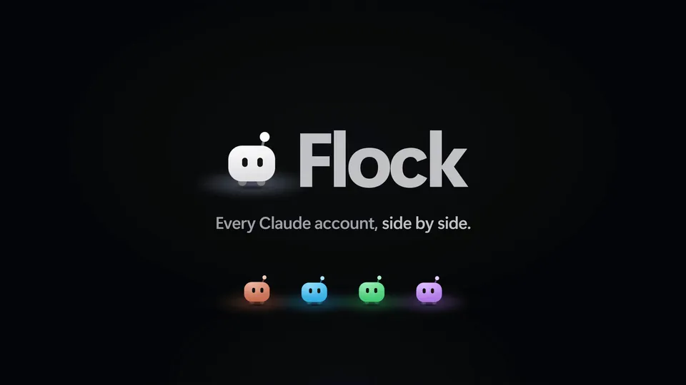
</p>

<table>
  <tr>
    <td width="50%" valign="top">
      
      <b>Every account at once</b><br>
      Each account gets its own Claude window. Sign in once, and it stays signed in.
    </td>
    <td width="50%" valign="top">
      
      <b>Always know where you're typing</b><br>
      Windows are titled after their account (<i>Work — Claude</i>) and get their own taskbar button and icon colour. The one you're typing in glows along its top edge.
    </td>
  </tr>
  <tr>
    <td width="50%" valign="top">
      
      <b>The island</b><br>
      A small bar at the top of the screen, one mascot per account. Hover it or press <kbd>Ctrl</kbd>+<kbd>Alt</kbd>+<kbd>F</kbd>, then click an account.
    </td>
    <td width="50%" valign="top">
      
      <b>Session peek</b><br>
      Hover an account to see its recent Claude Code sessions. Click one to jump back in, or start a new one in that account.
    </td>
  </tr>
  <tr>
    <td width="50%" valign="top">
      
      <b>Sign in once</b><br>
      Google and e-mail sign-in links reach the window that asked for them, not your main Claude window.
    </td>
    <td width="50%" valign="top">
      
      <b>Shared or separate setup</b><br>
      An account can share your <code>~/.claude</code> (CLAUDE.md, skills, plugins, settings) or keep its own.
    </td>
  </tr>
  <tr>
    <td width="50%" valign="top">
      
      <b>Stays out of the way</b><br>
      When a maximized browser or editor sits under the island, it slides away and lets clicks through. Rest the pointer on the top edge to bring it back.
    </td>
    <td width="50%" valign="top">
      
      <b>Keyboard friendly</b><br>
      <kbd>1</kbd>–<kbd>9</kbd> open accounts, <kbd>↑</kbd> <kbd>↓</kbd> move between them, <kbd>A</kbd> opens them all.
    </td>
  </tr>
  <tr>
    <td colspan="2" valign="top">
      
      <b>From your phone</b><br>
      Away from your PC? Start Claude Code on it from the Flock phone app, or carry on with a session you started there. Pick an account (it shows how much usage each has left), then a project, a new folder or one of its sessions, and open it in the Claude app. Works even when no session had Remote Control on, or when a session's context is full.
    </td>
  </tr>
</table>

## Get started

You need Windows 11 (10 may work, but it isn't tested) and [Claude Desktop](https://claude.ai/download), from the Microsoft Store or the classic installer.

1. Download **Flock Setup** from [Releases](https://github.com/HNF-FRN/flock/releases/latest) and run it. It installs for your user only, no admin needed.
   The installer isn't code-signed yet, so SmartScreen may warn you: *More info → Run anyway*. Or [build it yourself](#build-from-source).
2. Open Flock. The first time, its settings window opens.
3. **Add account**: give it a name and a colour, and choose its `~/.claude`:
   - **Shared** uses `~\.claude` like your other shared accounts (same CLAUDE.md, skills, plugins, settings and memory in the Code tab).
   - **Its own** gets a separate folder (`~\.claude-<name>`), optionally starting with a copy of your CLAUDE.md, settings.json and skills.
   - **Same as…** shares another account's own folder, for example across several work accounts.
4. Flock opens that account's window. **Sign in once**, with *Continue with email* (then click the button in the e-mail) or with Google.
5. Switch on *Open automatically when Flock starts* for the accounts you want every time, and *Start Flock with Windows*.

### Keys

| Keys | What they do |
|---|---|
| <kbd>Ctrl</kbd>+<kbd>Alt</kbd>+<kbd>F</kbd> | Open the island, from anywhere |
| <kbd>1</kbd> – <kbd>9</kbd> | Open that account |
| <kbd>↑</kbd> <kbd>↓</kbd> | Move between accounts |
| <kbd>A</kbd> | Open all accounts |
| <kbd>Ctrl</kbd>+click | Select several |
| Right-click | More options for an account |

## Use Flock from your phone

<p align="center">
  
</p>

Away from your PC? Flock can start Claude Code there, in any account and any project folder (even one you create from your phone), and give you a link that opens the session in the Claude app. It can also turn Remote Control on for a session you already started on the PC, so you carry on with it from your phone. That helps when no session had Remote Control on, or when a session's context is full and you want a fresh one.

You need [Claude Code](https://claude.com/claude-code) (the CLI) on the PC, and a Pro, Max, Team or Enterprise plan for each account you use this way. Remote Control doesn't work with API keys.

### Set it up once

1. **Get Flock on your phone.** On Android, open [Releases](https://github.com/HNF-FRN/flock/releases/latest) on the phone, download **Flock-*version*.apk** and open it (Android asks you to let your browser install apps). On any other phone, use the web version: it opens when you scan the pairing code with the camera.
2. **Pair it.** On the PC, open **Settings → Phone**, switch it on and press **Pair a phone**. In the Android app, tap **Scan the code** and point the camera at it. On another phone, scan the code with the camera and add the page that opens to your home screen.
3. **Sign each account's Claude Code in.** Under **Claude Code sign-in for each account**, press **Sign in** next to each account that isn't ready, and sign in with that account's Claude login in the browser that opens. Two accounts can share `~/.claude` and both start sessions from your phone, each as its own Claude account. Give any other account that shares it its own `~/.claude` (**Edit…** next to it).

### From your phone

- **Start a session.** Tap an account. Pick a recent project, browse to a folder or create a new one (as a git repository if you like). Give the session a name if you like (it's how the Claude app lists it), then tap **Start Claude here**. Then tap **Open the session**; the Claude app has to be signed in to that same Claude account. With a name, each start is a new conversation of its own, and **Continue it again** after stopping it reopens that conversation. Without one, Claude Code names the session from your first message, and **Start another session here** opens a fresh one in the same folder, for when a session's context is full.
- **Continue a session you started on the PC.** Open the account's **Sessions** tab (sessions are grouped by project, and picking a project lists its sessions too), tap one, change its name if you like, then **Continue on phone**. Flock reopens it with Remote Control on, with everything said so far.
- **Answer Claude Code.** When Claude Code asks whether to trust a folder, or the first time whether to turn on Remote Control, its question shows on your phone word for word, and your answer goes back to it.
- **Stop** a session on the phone, or in **Settings → Phone** on the PC.

<p align="center">
  
</p>

While the account's Claude window is open, it may still be using that session, and two programs writing one conversation would split it. So your phone carries on with a copy, and the window keeps the original. Back at your PC, **Settings → Phone → Open in its window** brings the copy into the window, with what you did on the phone. With the window closed, your phone carries on with the session itself. When you open the window again, Flock stops the session on the phone so the window can take over.

## How it works

<p align="center">
  
</p>

Claude Desktop is an Electron app, and Electron allows one window per **data folder**. So Flock starts each extra account with its own, through the Store build's own launch alias (so Claude updates don't break it):

```
claude-desktop.exe --user-data-dir=%APPDATA%\Claude-<name>
```

Main keeps Claude's default folder. Accounts that don't share `~/.claude` also get `CLAUDE_CONFIG_DIR`, which Claude Desktop and its Code tab read.

<p align="center">
  
</p>

Google and e-mail sign-in finish in the browser with a `claude://` link, and Windows always hands it to Main through a short-lived `Claude.exe "claude://…"` process. While an account waits for sign-in, Flock sees that process start (a WMI process-start event, about 0.1 s) and sends the link to the waiting window.

<details>
<summary><b>More on sign-in links</b></summary>
<br>

- **Google links:** Main keeps its copy too. It ignores a sign-in it didn't start, and it may be Main that is signing in.
- **E-mail and SSO links:** Flock stops the short-lived process before it reaches Main (Claude takes over a second to boot), so Main doesn't open a "Use verification code" page.
- **Connector sign-ins** in an extra account: right-click the account, then *Pass the next claude:// link here*.

Nothing is changed in the registry.
</details>

<p align="center">
  
</p>

From your phone, two things travel separately. Flock's own messages (start a session, stop it, Claude Code's questions and your answers) reach Flock on your PC through [ntfy.sh](https://ntfy.sh), a public relay, end-to-end encrypted. Flock then starts Claude Code with Remote Control on, under that account's Claude Code sign-in. Your conversation never passes through Flock: Claude Code and the Claude app exchange it through Anthropic, as in any Remote Control session.

<details>
<summary><b>More on the phone link</b></summary>
<br>

- **Starting a session:** without a name, each folder runs `claude remote-control`, the [Remote Control](https://code.claude.com/docs/en/remote-control) server from Claude Code. It starts with one session, and the Claude app can add more there. With a name, Flock runs `claude --session-id … --remote-control "<name>"`: a new conversation of its own under that name, with an id Flock picks, so it can be reopened with `--resume`. (A server can't be relied on to use a name: for a few hours after one stops, the next one in that folder brings back its session, under that session's name.)
- **Continuing one:** it is reopened with `claude --resume … --remote-control`, in its folder, with its model. As a copy, it gets `--fork-session` and an id Flock picks, so Claude's `claude://resume` link can bring it into the window later.
- **Claude Code's questions:** Flock runs Claude Code in a pseudo-console, so it asks what it asks in a terminal. Flock passes each question to your phone and types only your answer. It never answers a question itself and never sends a prompt: what Claude does is up to you, in the Claude app.
- **Sign-ins:** Claude Code keeps its sign-in in the config folder (on Windows, `.credentials.json` in `~/.claude`, or in `CLAUDE_CONFIG_DIR`), and whose it is in `.claude.json` (`~/.claude.json`, or in `CLAUDE_CONFIG_DIR`). An account with its own `~/.claude` uses that folder's. Two accounts can share `~/.claude` and still each have their own: one uses `~/.claude`'s own sign-in, the one Claude Code in a terminal uses. The other runs with `CLAUDE_CONFIG_DIR` set to `~/.claude` itself, so its name goes to `~/.claude/.claude.json`, and with `CLAUDE_SECURESTORAGE_CONFIG_DIR` set to a folder of Flock's (`%APPDATA%\Flock\sign-ins`), so its sign-in goes there. Both run with the same settings, skills, CLAUDE.md, memory and sessions. Flock matches sign-ins to accounts by organization, or by who was signed in from Flock. A third account sharing `~/.claude`, or a second sharing another account's own folder ("Same as…"), needs its own. Flock reads sign-in status from `claude auth status`, signs in with `claude auth login` and never reads credentials.
- **Encryption:** every message is sealed with AES-256-GCM under a key that exists only on your PC (sealed with Windows' DPAPI) and your phone. The key travels once, in the QR code, which shows only in Flock's settings and is left out of screenshots and screen sharing. The relay only ever sees scrambled data, over ordinary outgoing HTTPS: no open ports, no tunnel, no account.
- **GitHub** only hosts the phone app (a static page in `docs/app`, on GitHub Pages) and the downloads. Flock for Android (`android/`) is a small native app around the same page, with Google's code scanner for the pairing code; GitHub Actions builds and signs it for each release.
- **Folders:** your phone can browse, create folders and start sessions only inside your project folders and each account's recent projects. You set the project folders in **Settings → Phone**; by default they are your home folder and the folders that hold your recent projects.
- **Your PC** has to be on and awake, with Flock running. By default Flock keeps it from idle-sleeping while a phone is paired. Phone sessions stop when Flock quits; start the same folder again within about four hours and Claude Code brings its sessions back.
</details>

<details>
<summary><b>How windows are told apart</b></summary>
<br>

Claude draws every window the same way, so Flock marks them from the outside, without touching Claude or covering its content:

- **Names.** Each window is titled after its account (*Work — Claude*), which Alt+Tab, Win+Tab, taskbar previews and screen-share pickers show. Its icon there is Claude's own icon in the account's colour, and each account gets its own taskbar button (Main stays on Claude's own button while it keeps Claude's orange). A pinned account button opens that account through Flock (`Flock.exe --open=<id>`).
- **Accent edge.** A slim line in the account's colour along the top of each window, in the empty strip above Claude's title-bar controls. The window you're typing in gets the full colour and a soft glow. It takes no clicks, is skipped wherever another window covers it, and is left out of screenshots and screen sharing.
- **Island.** While a Claude window has focus, the island shows that account's mascot and name.

What Flock changes on a Claude window is its title, its icon (`WM_SETICON`) and its taskbar identity (the window's `System.AppUserModel` properties). Windows keeps these on the window only; nothing is written to Claude's files, settings or the registry. Flock puts every window back when you switch *Name each window* off or quit Flock (also `Flock.exe --quit`). If Flock is killed instead, the windows keep their names until Flock runs again or Claude restarts, and Alt+Tab may show them without an icon meanwhile.

The coloured icons are drawn on your PC from the installed Claude app's own icon and kept in `%APPDATA%\Flock\icons`. A small helper reads where the windows are (window order, frame bounds, Windows' window events). Settings → *Claude windows* switches each part on or off.
</details>

<details>
<summary><b>Session peek</b></summary>
<br>

Claude Desktop keeps a small file per Code session in each account's data folder (`claude-code-sessions\<account>\<organization>\local_*.json`). Flock reads the title, folder and last activity from the signed-in account's files (archived and removed sessions are left out), and opens a session with Claude's own link, `claude://code/continue?session=…`, sent to that account's window like the sign-in links. Only local Code sessions are listed, not cloud ones.

A session already open in a window of its own (Claude's *Open in → New window*) is listed first and marked **Window**: clicking it brings that window to the front, restored if it was minimized. Claude's link would always open the session in the main window, so Flock reads which sessions Claude has in their own windows (`session-popouts.json` in the data folder) and finds that window by its title, or else by where Claude last saw it. Flock can't open a session in a new window itself: Claude has no link for that, only its own *Open in* menu.

In the island, **New** starts a Code session in that account, the **+** on a session starts one in that session's folder, and the magnifier opens Claude's session search.
</details>

<details>
<summary><b>Where things live</b></summary>
<br>

- The Microsoft Store build of Claude stores what it writes under `%APPDATA%` in `%LOCALAPPDATA%\Packages\Claude_…\LocalCache\Roaming\`, so the account folders live there.
- Flock reads two fields from each account's `config.json` (the last account id), to show "signed in" and to warn when two windows use one account.
- Flock's own settings and log are in `%APPDATA%\Flock\`. `flock.log` records links without their codes.
</details>


**What Flock doesn't do.** It doesn't read or store your login, doesn't sit between you and Claude, and never switches accounts for you. Every window is the normal Claude app with its own data folder, and you sign in to each one yourself.

## Good to know

- Only one account at a time can run **Cowork**'s VM. That's a Claude limitation.
- Don't sign the same Claude account into two windows, chat sync gets confused. Flock warns you when it sees that.
- Removing an account can keep its data (re-add it later, still signed in) or move it to the Recycle Bin.
- Sessions started from your phone run in Claude Code (the CLI), not in the account's Claude window. They show up in the Claude app and at claude.ai/code, not in the window's sidebar.
- Windows only for now.

## Build from source

```bash
npm install
npm start
```

| Command | What it does |
|---|---|
| `npm run dist` | Builds `dist\Flock Setup <version>.exe` (per-user install, no admin) |
| `npm run icons` | Draws the app, tray, phone-app and Android icons from the mascot |
| `node scripts/phone-app.mjs` | Copies the shared files into the phone app (`docs/app`) after you change them |
| `gradle assembleDebug` (in `android/`) | Builds Flock for Android, with the Android SDK; releases are built by `.github/workflows/android.yml` |
| `node scripts/readme-art.mjs` | Redraws the artwork in this README |

`dev/` holds a mascot preview page and `dev/cdp.js`, which drives a dev run started with `--remote-debugging-port=9339`. The accent edge is left out of screenshots; start a dev run with `FLOCK_EDGE_CAPTURE=1` to capture it.

The film at the top is made in code too: plain HTML, CSS and JS rendered frame by frame. See [`video/`](video/).

## Credits

- The island's look and palette follow [Coucou](https://github.com/Louis-CFM/coucou)'s MIT-licensed code (see [THIRD_PARTY_NOTICES.md](THIRD_PARTY_NOTICES.md)).
- Flock's mascot is its own character, made for Flock. It isn't Anthropic's Clawd or Coucou's Mochi.
- Film music: "Cat Walk" by Arulo, under the Mixkit Stock Music Free License. Sound effects from Mixkit.
- Flock ships no Anthropic artwork. The coloured Claude icons are drawn at run time from the copy of Claude on your PC, so keep them out of screenshots you publish.

Flock is an independent project. It is not made by, or affiliated with, Anthropic. Claude is a trademark of Anthropic.

## License

[MIT](LICENSE)
